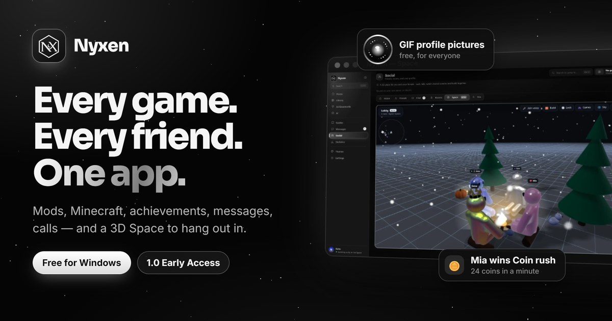

<h1 align="center">Nyxen</h1>

<b>Every game. Every friend. One app.</b> 
Free for Windows 10 and 11 &middot; 1.0 Early Access

  <a href="https://github.com/Kerioxsx/nyxen/releases/latest"><b>Download</b></a> &middot;
  <a href="https://kerioxsx.github.io/nyxen/"><b>Website</b></a>

- **Nyxen Space** - a 3D place to hang out with your friends: voice that fades
  with distance, shared screens on a TV, Coin rush and Tag, weather and building.
- **GIF profile pictures for everyone** - and a GIF banner, your song and what
  you are playing. Free.
- **Mods** from Thunderstore, GameBanana, Nexus Mods and the Steam Workshop in
  one search; **Minecraft** with the launcher you already use, and your world in 3D.
- **Achievements, retro games** (RetroArch, 141 systems) and your whole Steam library.
- **Messages, calls, rooms** and music together.
- **63 themes**, 23 of them animated, and 11 layouts.

Installs per-user without administrator rights and updates itself. You make a
free Nyxen account in the app.

The installer is not code-signed, so SmartScreen will warn you the first
time (More info, then Run anyway). The SHA-256 is published beside the
download and in `sha256.txt`.
